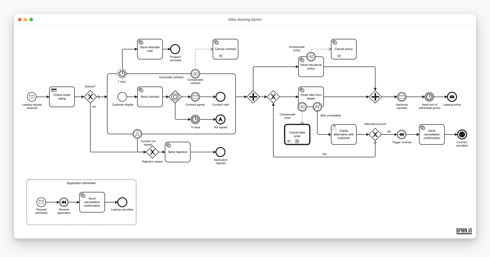

# Fluxnova Bike-Leasing Blueprint

[](LICENSE)

A solution template to fork for automating a business process on [Fluxnova](https://fluxnova.finos.org)
(the FINOS-governed fork of Camunda 7): one complete, production-shaped BPMN service with the engine
**embedded** in Spring Boot — no remote engine, no separate engine container. It is the Fluxnova port of
the [CIB seven embedded example](../cibseven-embedded/README.md)
([migration notes](docs/fluxnova-migration.md)) and still a work in progress.

> [!WARNING]
> **Experimental.** This example is only a test for now: it is not listed in the overview of this
> repository yet, and it may change or go away without notice.

<!-- variant:blueprint -->
## Pick your stack

| | [`kotlin-gradle/`](kotlin-gradle/README.md) | [`java-maven/`](java-maven/README.md) |
|---|---|---|
| **Stack** | Kotlin 2.4 · Gradle | Java 21 · Maven |
| **Choose it when** | you are free to choose — **our recommendation for a modern stack** | Java + Maven is your team's or company's standard, or you are in a training |

Both run the same process behind the same REST contract, and CI keeps their models and configuration
identical. Building on one? [Turn the repo into a single-stack starter](docs/starter.md).
<!-- /variant:blueprint -->

## The process



**MiraVelo** is a fictional bike brand that sells on a leasing model. The service takes a leasing
application from the first request to an active lease and deliberately covers the BPMN elements you
meet in real processes: a message start event, JavaDelegate service tasks and a DMN business-rule task,
an embedded sub-process with an event-based gateway and a non-interrupting reminder timer, a parallel
fork/join, a user task with a Fluxnova Form (completable in the Tasklist or via REST), execution and
task listeners, compensation guarded by error and escalation boundary events, a call activity, a
withdrawal message event sub-process and a terminate end event.

## Quick start

Requires JDK 21 and Docker (or Podman).

```bash
docker compose -f stack/docker-compose.yml up -d   # Postgres on :5432
# variant:kotlin-gradle
cd kotlin-gradle && ./gradlew :service:app:bootRun   # service + embedded engine on :8080
# /variant:kotlin-gradle
# variant:java-maven
cd java-maven && ./mvnw -DskipTests install && ./mvnw -pl service/app spring-boot:run   # service + embedded engine on :8080
# /variant:java-maven
```

| What | URL | Login |
|---|---|---|
| Fluxnova Monitoring / Tasklist / Admin webapps | <http://localhost:8080/fluxnova> | admin / admin |
| Swagger UI | <http://localhost:8080/swagger-ui.html> | |

Drive the whole process over REST: `cd bruno && npx --yes @usebruno/cli@4.0.0 run . --env local -r`.
Tests, ports and containers are in [CONTRIBUTING.md](CONTRIBUTING.md); the known limitations (Spring Boot line,
Jackson workaround, `camunda:` namespaces) are in the [migration notes](docs/fluxnova-migration.md#8-blockers-workarounds-and-open-fluxnova-issues).

## What's inside

| Path | Content |
|---|---|
| [`openapi/`](openapi/openapi.json) | the checked-in, drift-gated OpenAPI contract |
| [`bruno/`](bruno/README.md) | REST scenarios, the two ways to complete a user task, the incident demo |
| [`stack/`](stack/docker-compose.yml) | the Postgres dev stack |
| [`docs/`](docs/README.md) | the Architecture Decision Records and the Fluxnova migration notes |

## Contributing

See [CONTRIBUTING.md](CONTRIBUTING.md) and [AGENTS.md](AGENTS.md).

## License

[MIT](LICENSE) © Miragon GmbH.
