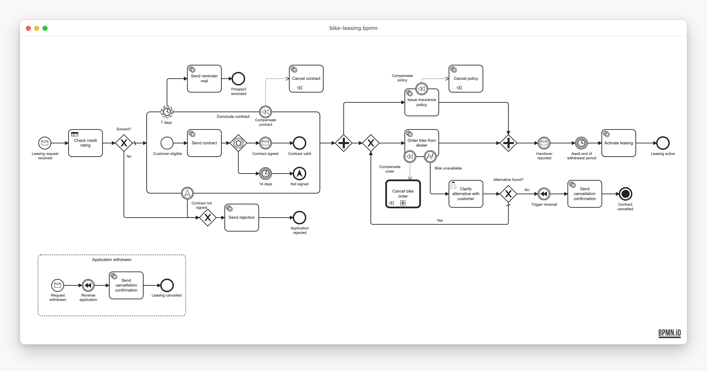

# Camunda 8 + process-engine-api Bike-Leasing Blueprint

<!-- variant:blueprint -->
[](./LICENSE)
<!-- /variant:blueprint -->

A ready-to-fork starting point for automating a business process on [Camunda 8](https://camunda.com)
(Zeebe, self-managed) with Spring Boot — one complete, runnable, production-shaped BPMN service. It
targets an external Zeebe broker and reaches it only through the bpm-crafters
[process-engine-api](https://github.com/bpm-crafters/process-engine-api): each BPMN service task is a
`@ProcessEngineWorker` method, and the process is started, correlated and completed through the API's
interfaces, so your service code carries no engine types. It is a work-in-progress solution template to
build on, not a product that ships.

<!-- variant:blueprint -->
## Pick your stack

| | [`kotlin-gradle/`](kotlin-gradle/README.md) | [`java-maven/`](java-maven/README.md) |
|---|---|---|
| **Stack** | Kotlin 2.4 · Gradle | Java 21 · Maven |
| **Choose it when** | you are free to choose — **our recommendation for a modern stack** | Java + Maven is your team's or company's standard, or you are in a training |

Both run the same process behind the same REST contract; [turn the repo into a single-stack starter](docs/starter.md) with one command.
<!-- /variant:blueprint -->

<!-- variant:blueprint -->
## What differs from `zeebe-native`

The process, the REST contract and the scenarios are the same as in [`zeebe-native`](../zeebe-native/README.md).
Only the way the service talks to Zeebe changes:

| | `zeebe-native` | this example |
|---|---|---|
| Service tasks | `@JobWorker`, explicit job commands | `@ProcessEngineWorker`, return value or `BpmnErrorOccurred` |
| Start and messages | `CamundaClient` | `StartProcessApi`, `CorrelationApi` |
| Completing a user task | search plus client command | `UserTaskSupport` pool plus `UserTaskCompletionApi` |
| Task inbox | search plus variables per task | the same pool |

[ADR-0014](docs/adr/0014-process-engine-api-on-camunda-8.md) records the decisions, what they cost and when
to pick which example.
<!-- /variant:blueprint -->

## The process



**MiraVelo** is a (fictional) bike brand that sells on a leasing model. This service automates a
leasing application from the first request to an active lease and deliberately walks through the broad
palette of BPMN elements you meet in real processes: a message start event, service tasks (workers)
and a DMN business-rule task, an embedded sub-process with an event-based gateway and a non-interrupting
reminder timer, a parallel fork/join, user tasks completed through domain REST endpoints, compensation /
SAGA handlers guarded by error and escalation boundary events, a call activity, a message event
sub-process (withdrawal) and a terminate end event.

## Quick start

Requirements: **JDK 21** and **Docker** (or Podman) with about 8 GB of memory for the stack.

Start the local Zeebe environment first. It runs the Camunda 8 orchestration cluster (Zeebe, Operate and
Tasklist in one container), Elasticsearch as its secondary storage and the service's Postgres:

```bash
docker compose -f stack/docker-compose.yml up -d --wait   # returns once the stack is healthy
```

Then start the service. It connects to Zeebe on `:26500`, deploys the models and listens on `:8081`:

```bash
# variant:kotlin-gradle
cd kotlin-gradle && ./gradlew :service:app:bootRun
# /variant:kotlin-gradle
# variant:java-maven
cd java-maven && ./mvnw -pl service/app -am spring-boot:run
# /variant:java-maven
```

| What | URL | Login |
|---|---|---|
| Operate / Tasklist | <http://localhost:8080> | demo / demo |
| Swagger UI | <http://localhost:8081/swagger-ui.html> | — |

Stop the stack with `docker compose -f stack/docker-compose.yml down`, and add `-v` to delete its data.

Drive the whole process over REST with the [Bruno](bruno/README.md) scenarios: `cd bruno && npx --yes @usebruno/cli@4.0.0 run . --env local -r --exclude-tags=demo-data`.
Setup, ports, containers and the PR workflow are in [`CONTRIBUTING.md`](CONTRIBUTING.md).

## What's inside

| Path | Content |
|---|---|
| [`openapi/`](openapi/openapi.json) | the checked-in, drift-gated OpenAPI contract |
| [`bruno/`](bruno/README.md) | the REST scenarios, the two ways to complete a user task, the incident demo |
| [`stack/`](stack/docker-compose.yml) | the Camunda 8 self-managed dev stack and Postgres |
| [`docs/`](docs/README.md) | the Architecture Decision Records: why the repo is shaped this way |

## Contributing

Bug reports and feature ideas are welcome as issues — see [`CONTRIBUTING.md`](CONTRIBUTING.md) and use [Conventional Commits](https://www.conventionalcommits.org).

## License

Licensed under the [MIT License](./LICENSE).
