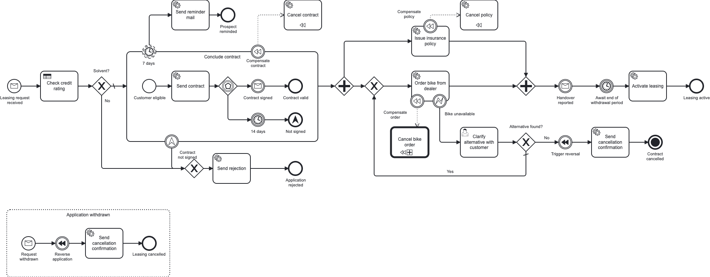

# MiraVelo bike leasing (Camunda 8 + VanillaBP)
[](https://github.com/miragon-blueprints/zeebe-vanilla-bp-example/actions/workflows/pre-merge-kotlin-gradle.yml) [](https://github.com/miragon-blueprints/zeebe-vanilla-bp-example/actions/workflows/pre-merge-java-maven.yml) [](LICENSE)

A solution template to fork for automating a business process on [Camunda 8](https://camunda.com)
(Zeebe, self-managed): one complete, production-shaped BPMN service with Spring Boot that targets an
external Zeebe broker and binds each BPMN task to a use case through [VanillaBP](https://www.vanillabp.io).
This branch is a spike comparing VanillaBP with the plain Zeebe integration, written up in
[docs/vanillabp-spike.md](docs/vanillabp-spike.md), and still a work in progress.

<!-- variant:blueprint -->
## Pick your stack

| | [`kotlin-gradle/`](kotlin-gradle/README.md) | [`java-maven/`](java-maven/README.md) |
|---|---|---|
| **Stack** | Kotlin 2.4 · Gradle | Java 21 · Maven |
| **Choose it when** | you are free to choose — **our recommendation** | Java + Maven is your standard, or you are in a training |

Both run the same process behind the same REST contract; CI keeps their models and configuration
identical. Building on one? [Turn the repo into a single-stack starter](docs/starter.md).
<!-- /variant:blueprint -->

## The process



**MiraVelo** is a fictional bike brand that sells on a leasing model. The service takes a leasing
application from the first request to an active lease and deliberately covers the BPMN elements you
meet in real processes: message start, VanillaBP workflow tasks and a DMN rule, an embedded
sub-process with an event-based gateway and reminder timer, a parallel fork/join, a user task
completed through a REST endpoint, compensation guarded by error and escalation events, a call
activity, a withdrawal event sub-process and a terminate end event.

## Quick start

Requires JDK 21 and Docker or Podman.

```bash
docker compose -f stack/docker-compose.yml up -d   # Zeebe, Operate, Tasklist, Elasticsearch, Postgres
# variant:kotlin-gradle
cd kotlin-gradle && ./gradlew :service:app:bootRun   # service on :8081
# /variant:kotlin-gradle
# variant:java-maven
cd java-maven && ./mvnw -DskipTests install && ./mvnw -pl service/app spring-boot:run   # service on :8081
# /variant:java-maven
```

| What | URL | Login |
|---|---|---|
| Operate / Tasklist | <http://localhost:8080> | demo / demo |
| Swagger UI | <http://localhost:8081/swagger-ui.html> | |

Drive the whole process over REST: `cd bruno && npx --yes @usebruno/cli@4.0.0 run . --env local -r`.
Tests, ports and containers are in [CONTRIBUTING.md](CONTRIBUTING.md).

## What's inside

| Path | Content |
|---|---|
| [`openapi/`](openapi/openapi.json) | the checked-in, drift-gated REST contract |
| [`bruno/`](bruno/README.md) | REST scenarios, the two ways to complete a user task, the incident demo |
| [`stack/`](stack/docker-compose.yml) | the Camunda 8 self-managed dev stack |
| [`docs/`](docs/README.md) | the Architecture Decision Records and the VanillaBP spike write-up |

## Contributing

See [CONTRIBUTING.md](CONTRIBUTING.md) and [AGENTS.md](AGENTS.md).

## License

[MIT](LICENSE) © Miragon GmbH.
